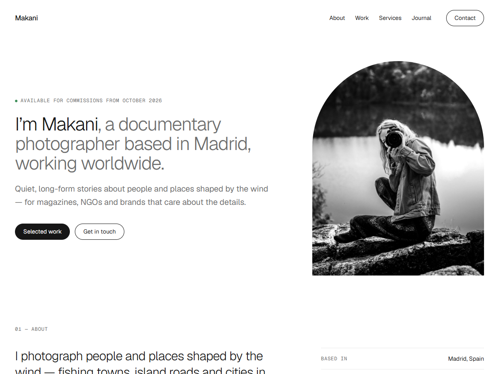

# Makani

  

Makani is a refined, minimalist block theme for a personal website or portfolio. A calm homepage is ready right after activation: an introduction with an arch-shaped portrait, about section with quick facts, selected work gallery, services list, latest blog posts and a contact section. Light Geist typography, small monospaced labels, hairline details, a white and a dark (Ink) style. Made for photographers, designers, writers, freelancers and creatives — edit everything in the Site Editor, no code required.

- **WordPress.org:** https://wordpress.org/themes/makani/
- **Live preview:** https://wp-themes.com/makani/

## Description

Makani is a calm, minimalist block theme for photographers, designers, writers, freelancers and anyone who needs a personal website or an online portfolio. The homepage is ready the moment you activate the theme: an introduction with an arch-shaped portrait and call-to-action buttons, an about section with quick facts, a selected work gallery with captions, a numbered services list, the latest blog posts and a contact section with your e-mail and social links.

Every homepage section is also available as a block pattern in the "Makani" category, so you can reorder sections or reuse them on other pages. Everything is editable in the Site Editor — no code required.

**Features:**

* Ready-made homepage in the Front Page template
* White default style and a dark style variation (Ink)
* Light Geist typography with Geist Mono labels, bundled locally
* Custom mobile menu built on the Navigation Overlay template part
* Block styles: Arch image, Label paragraph, Tags for post terms
* Templates for the blog, single posts, pages, archives, search, 404 and a Blank page
* Accessible color contrast, underlined links and visible focus styles
* Translation ready

## Installation

1. In your WordPress admin panel, go to Appearance > Themes and click "Add New Theme".
2. Search for "Makani", or click "Upload Theme" and choose makani.zip.
3. Click "Install" and then "Activate". The homepage appears right away.
4. Go to Appearance > Editor to change texts, photos, colors and fonts.
5. For a separate blog page, create an empty page and choose it as the "Posts page" in Settings > Reading.

To install the development version from this repository, download it as a ZIP (Code > Download ZIP), rename the folder inside to `makani` and upload it in Appearance > Themes > Add New Theme > Upload Theme.

## Frequently Asked Questions

### How do I switch to the dark style?
Go to Appearance > Editor > Styles, open "Browse styles" and choose "Ink".

### How do I edit the mobile menu?
Go to Appearance > Editor > Patterns > Template Parts and open "Navigation Overlay".

## Requirements

- WordPress 7.0 or later
- Tested up to WordPress 7.1
- PHP 7.4 or later

## Changelog and credits

The full changelog, image and font credits with their licenses are listed in [readme.txt](readme.txt).

## License

Makani is distributed under the terms of the [GNU General Public License v2 or later](https://www.gnu.org/licenses/gpl-2.0.html).

---

More themes by Roman Fink: https://wordpress.org/themes/author/romanfink/
